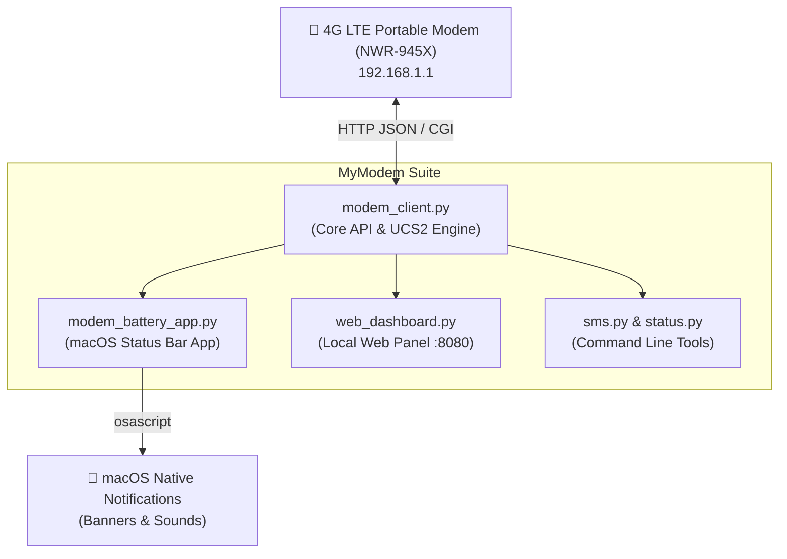

# 📶 MyModem — macOS Status Bar Widget, SMS Suite & Telemetry Center

<div align="center">


<p align="center">
  <b>A lightweight, native macOS Menu Bar companion and modern web control panel for portable 4G LTE modems (NWR-945X & MiFi series).</b>
  <br />
  پایش هوشمند شارژ باتری، خواندن و ارسال پیامک، تشخیص تماس‌های بی‌پاسخ و مدیریت کدهای USSD مودم همراه در مک‌اواس.
</p>

[ویژگی‌ها](#-امکانات-و-ویژگیها) • [نصب سریع](#-نصب-و-راهاندازی-سریع) • [داشبورد وب](#-داشبورد-تحت-وب-web-dashboard) • [ابزار خط فرمان](#-ابزار-خط-فرمان-cli) • [Architecture](#-architecture)

</div>

---

## 🌟 امکانات و ویژگی‌ها

- 🔋 **ویجت زنده در منوبار مک (Status Bar Item):**
  - نمایش درصد لحظه‌ای باتری مودم (`🔋 30%` در مصرف، `⚡ 30%` هنگام شارژ).
  - هشدار هوشمند روی ۱۰٪ با صدای اعلان سیستم برای اتصال شارژر.
  - هشدار بحرانی روی ۵٪ پیش از خاموش شدن ناگهانی مودم.
  - جلوگیری از اسپم هشدارها و ریست خودکار وضعیت پس از اتصال به برق.
  
- 💬 **صندوق و مرکز پیامک کامل (SMS Engine):**
  - رمزگشایی و انکودینگ دوطرفه UTF-16BE / UCS2 با پشتیبانی بی‌نقص از حروف فارسی و ایموجی‌ها (🔥، 🎉، ...).
  - خواندن پیامک‌های دریافتی همراه با نام یا شماره فرستنده و تاریخ دریافت.
  - ارسال پیامک جدید به هر شماره همراه مستقیماً از مک.
  - حذف پیامک‌ها با یک کلیک.

- 📞 **سیستم هوشمند پایش تماس‌های بی‌پاسخ (Missed Call Alert):**
  - مودم‌های دیتا قابلیت مکالمه صوتی ندارند، اما اپراتورها برای هر تماس یک پیامک رایگان ارسال می‌کنند.
  - سیستم به صورت خودکار پیامک‌های تماس اپراتور را آنالیز کرده و به محض زنگ خوردن سیم‌کارت، نوتیفیکیشن اختصاصی مک صادر می‌کند:
    > **«📞 تماس از دست رفته جدید از طرف ۰۹۱۲...»**

- 🔢 **پشتیبانی کامل از کدهای دستوری (USSD):**
  - شماره‌گیری مستقیم کدهای دستوری (مثل `*100#`، `*140*11#`، `*1#`) جهت بررسی مانده بسته، حجم باقیمانده اینترنت و اعتبار ریالی سیم‌کارت بدون خارج کردن سیم‌کارت.

- 🌐 **داشبورد لوکال مدرن (Modern Web Panel):**
  - پنل تحت وب با طراحی Dark Glassmorphism، بسیار سبک و زیبا با فونت خوانای فارسی.
  - در دسترس روی آدرس محلی `http://127.0.0.1:8080`.

- 🚀 **سرویس دائمی در پس‌زمینه (macOS LaunchAgent):**
  - اجرای خودکار و بی‌صدا هنگام روشن شدن سیستم بدون اشغال فضای داک یا باز ماندن ترمینال.

---

## 🏗 Architecture



---

## 🚀 نصب و راه‌اندازی سریع

### پیش‌نیازها
- سیستم‌عامل **macOS** (نسخه Monterey به بعد)
- **پایتون ۳.۹ به بالا** (Python 3.9+)

### گام‌های اجرا

۱. **کلون کردن ریپازیتوری:**
```bash
git clone https://github.com/Matinsojoudi/MyModem.git
cd MyModem
```

۲. **فعال‌سازی و اجرای خودکار (یک کلیک):**
کافیست اسکریپت نصب را اجرا کنید تا محیط مجازی ساخته شده، بسته‌ها نصب شوند و برنامه در استارتاپ مک قرار گیرد:
```bash
chmod +x *.sh *.py
./install_autostart.sh
```
بلافاصله درصد باتری مودم در نوار بالای مک ظاهر شده و پنل تحت وب فعال می‌شود!

۳. **توقف یا حذف از استارتاپ:**
```bash
./uninstall_autostart.sh
```

---

## 🌐 داشبورد تحت وب (Web Dashboard)

به محض اجرای برنامه، داشبورد تحت وب روی مرورگر شما در دسترس است:
👉 **[http://127.0.0.1:8080](http://127.0.0.1:8080)**

همچنین با کلیک روی آیکون باتری در منوبار مک و انتخاب گزینهٔ **«💬 صندوق پیامک‌ها و پنل مدیریت (وب)»**، این صفحه بلافاصله باز می‌شود.

### بخش‌های داشبورد:
| تب | توضیحات |
|---|---|
| **📥 پیامک‌ها و تماس‌ها** | نمایش لیست کامل پیامک‌ها با بج مخصوص برای تماس‌های بی‌پاسخ، دکمه پاسخ و حذف |
| **✏️ ارسال پیامک** | فرم ساده و سریع ارسال پیامک به هر شماره |
| **🔢 کدهای دستوری (USSD)** | شماره‌گیری کدهای دستوری همراه با کلیدهای میانبر کدهای پرکاربرد |
| **⚙️ کنترل مودم** | مشاهده سرعت دانلود/آپلود، کیفیت سیگنال و دکمه ری‌استارت نرم‌افزاری مودم |

---

## 💻 ابزار خط فرمان (CLI)

برای انجام سریع کارها از داخل ترمینال، ابزار `sms.py` در اختیار شماست:

```bash
# مشاهده آخرین پیامک‌های دریافتی
./.venv/bin/python3 sms.py inbox

# ارسال پیامک جدید
./.venv/bin/python3 sms.py send 09123456789 "سلام وقت بخیر"

# مشاهده فهرست تماس‌های بی‌پاسخ
./.venv/bin/python3 sms.py calls

# اجرای کد دستوری
./.venv/bin/python3 sms.py ussd "*100#"

# مشاهده وضعیت زنده مودم و باتری
./.venv/bin/python3 status.py
```

---

## 📂 ساختار فایل‌های پروژه

```text
MyModem/
├── modem_client.py              # کلاینت ارتباطی اندپوینت‌های مودم، انکودینگ UTF-16BE و USSD
├── modem_battery_app.py         # برنامه نوار منوی مک (AppKit / rumps) و سیستم نوتیفیکیشن
├── web_dashboard.py             # سرور و داشبورد ریسپانسیو وب (پورت ۸۰۸۰)
├── sms.py                       # ابزار خط فرمان برای پیامک، تماس و USSD
├── status.py                    # اسکریپت نمایش خلاصه وضعیت در ترمینال
├── install_autostart.sh         # اسکریپت فعال‌سازی سرویس launchd مک
├── uninstall_autostart.sh       # اسکریپت توقف و حذف سرویس
├── com.matthew.modembattery.plist # تنظیمات استاندارد LaunchAgent مک‌اواس
└── requirements.txt             # وابستگی‌های پایتون (rumps, requests)
```

---

## ⚙️ سازگاری دستگاه‌ها

این برنامه برای مودم‌های همراه ۴G مدل **NWR-945X** (تراشه Marvell) مهندسی معکوس و بهینه‌سازی شده است و با تمام مودم‌های هم‌خانواده که از فریمور `duster` / `xml_action.cgi` استفاده می‌کنند کاملاً سازگار است.

---

## 📄 لایسنس

این پروژه تحت لایسنس [MIT](LICENSE) منتشر شده است و استفاده از آن آزاد می‌باشد.
